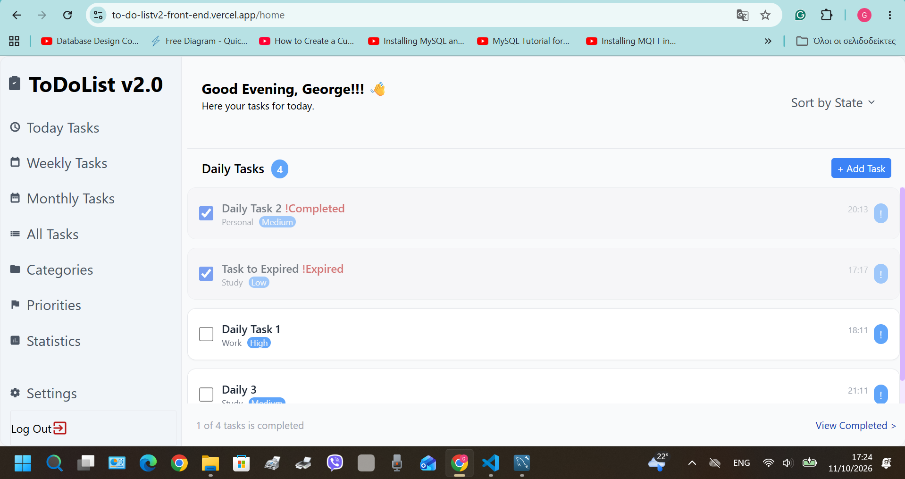
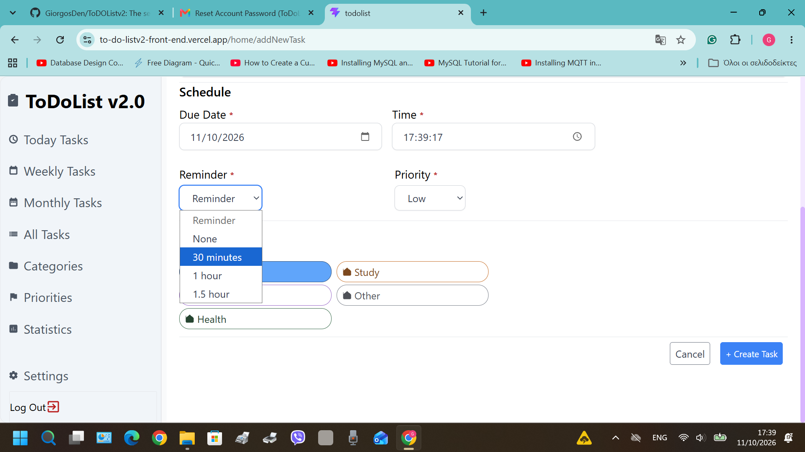
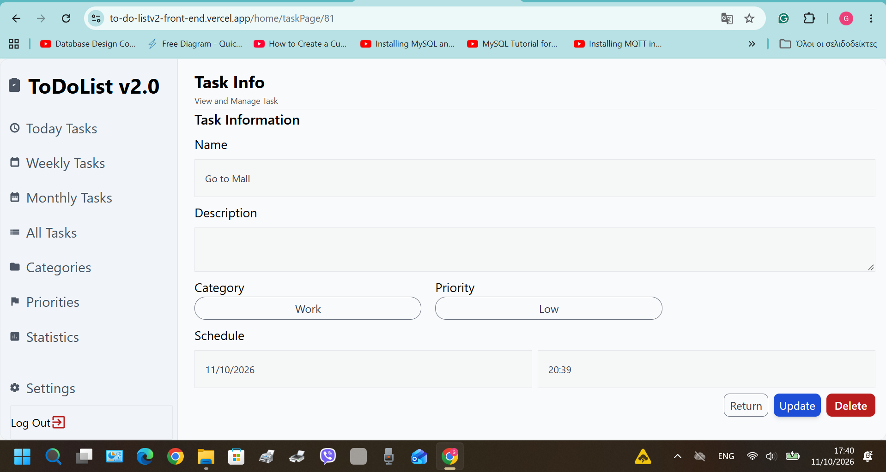
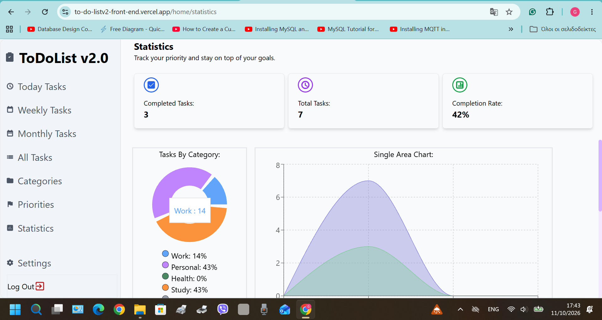
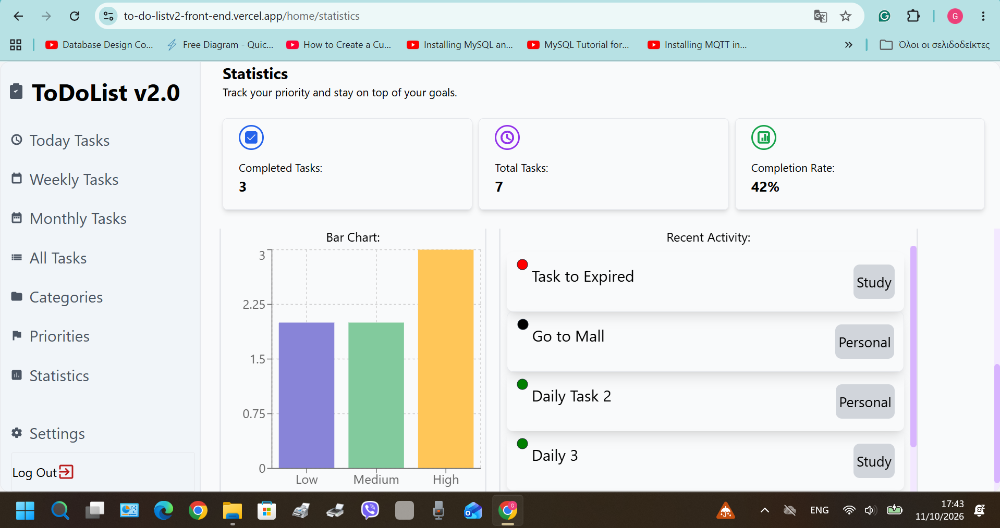

> [!NOTE]
> **Project Status:** ToDoListApp's 1st completed version has been revealed at ([Live v2](https://to-do-listv2-front-end.vercel.app/))
> 
> Check the Roadmap from the previous version ([Version 1.0](https://github.com/GiorgosDen/ToDoListv1))

# 📋 TaskMaster Full-Stack App (v2.0) — Documentation Hub

Welcome to the central documentation and project overview for **TaskMaster (v2.0)**, a full-stack web application built as a milestone project following the completion of my military service. 

This repository serves as the master documentation hub, outlining the architecture, features, and evolution of the application from its initial front-end prototype (`v1.0`) to a fully persistent, secure full-stack system (`v2.0`).

# App's QR code:

---

## 🔄 Project Evolution: v1.0 vs. v2.0

| Feature Area | Version 1.0 (Frontend Only) | Version 2.0 (Full-Stack Architecture) |
| :--- | :--- | :--- |
| **Data Storage** | Browser `LocalStorage` with a daily reset strategy. | Persistent **MySQL Database** for reliable multi-day storage. |
| **Authentication** | Client-side mock validation and sign-up constraints. | Server-side validation, **bcrypt** password hashing, and **JWT** security. |
| **Task Management** | Daily tasks only with real-time state management. | Expanded **Daily, Weekly, and Monthly** task management via DB interaction. |
| **UI/UX Design** | Mobile-first drawer navigation (responsive SPA). | Expanded responsiveness, optimized for both mobile devices and **large desktop screens**. |

---

## ✨ Core Features & Functionality (v2.0)

### 🔐 Authentication & User Management
* [x] **Secure Sign-Up & Login:** New user data is securely stored in the database with encrypted credentials.
* [x] **Token-Based Security:** Uses **JWT (JSON Web Tokens)** and **bcrypt** for protected routing and password hashing.
* [x] **Profile Updates:** Real-time state management for updating user connection data.
* [X] **Verification:** Verification emails follow the user through account-vital processes (Sign-Up, Change Account Email, Account Deregister). 

### 📝 Advanced Task Management
* [x] **Flexible Time Periods:** Organize and view tasks across **Daily, Weekly, and Monthly** intervals.
* [X] **Status Controls:** Real-time state management for creating, completing, and deleting tasks.
* [X] **Selective Updates:** Ability to update task details (Name, Title, DayTime, and more).
* [x] **Categorization & Priorities:** Create, update, and delete custom task categories alongside a dedicated priority view for better workflow management.
* [X] **Prioritization:** Organize task priorities on 3 schedules (Low, Medium, High). 
* [x] **Analytics:** Visual statistics tracking task completion and productivity.

---

## 🖼️ App Screenshots

### 1. Task Management
<table align="center">
  <tr>
    <td align="center" width="33%">
      <b>Daily Tasks View</b>  
      
    </td>
    <td align="center" width="33%">
      <b>Add New Task Form</b>  
      
    </td>
    <td align="center" width="33%">
      <b>Task Page View</b>  
      
    </td>
  </tr>
</table>

### 2. Analytics
<table align="center">
  <tr>
    <td align="center" width="50%">
      <b>Main Dashboard View</b>  
      
    </td>
    <td align="center" width="50%">
      <b>Analytics & Stats</b>  
      
    </td>
  </tr>
</table>

---

## 🏗️ System Architecture & Repositories

The project is structured following a modular multi-repo approach:

* [X] **[TaskMaster Frontend](https://github.com/GiorgosDen/ToDoListv2FrontEnd)** — Built with **React.js, JavaScript (ES6+), and React Router** (Hosted on Vercel).
* [X] **[TaskMaster Backend](https://github.com/GiorgosDen/ToDOListv2BackEnd)** — Built with **Node.js, Express.js**, handling RESTful endpoints, authentication, and database connections (Hosted on Render).
* [X] **Database (MySQL)** — Relational database schema designed for users, tasks, categories, and states (Find at TaskMaster Backend - Hosted on Aiven).

---

## 🛠️ Complete Project Infrastructure Stack
### 🚀 Backend (Render)
* Plan: Free Tier
* Workspace: Dedicated individual workspace
* Bandwidth: 5 GB included ($0.15/GB thereafter)
* Custom Domains: Up to 2 custom domains ($0.25/domain thereafter)
* Build Minutes: 500 minutes per month
* Projects & Environments: Unlimited projects (with up to 2 environments)
* Service Capacity: Deploy up to 25 services

### 🌐 Frontend (Vercel)
* Plan: Hobby Plan (Free Tier)
* Data Transfer: Up to 100 GB per month (fair-use bandwidth limit)
* Deployments: Up to 100 deployments created per day
* Serverless Functions: 1,000,000 invocations included per month
* Build Limits: Up to 45 minutes max duration per individual build with 1 concurrent deployment

🗄️ Database (Aiven MySQL)
* Plan: Free Tier
* CPU: 1 vCPU
* Memory: 1 GB RAM
* Storage: 1 GB storage limit

### 📧 Email / SMTP (Brevo)
*   **Plan:** Free Tier
*   **Service:** Default SMTP relay for transactional emails (e.g., account verification, notifications)
*   **Volume Limit:** Up to 300 emails per day on the free plan

---

## 🗺️ Roadmap (Upcoming v3.0 Features)

- [ ] **User Groups:** Collaborative group tasks and team-based workspaces.
- [ ] **Hierarchy:** Task and team level structures.
- [ ] **Advanced Statistics:** Atomic (individual) and group-level performance statistics.

---
*Developed by Giorgos Den.*
